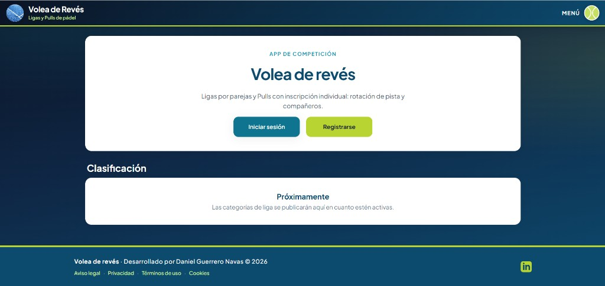
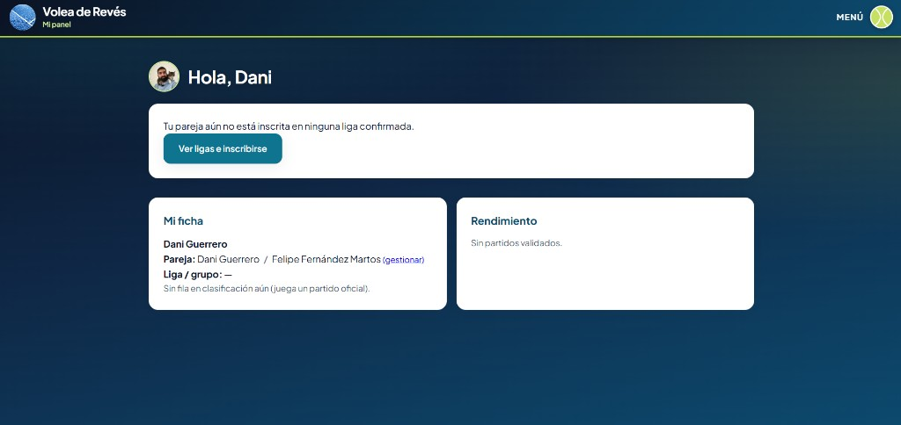
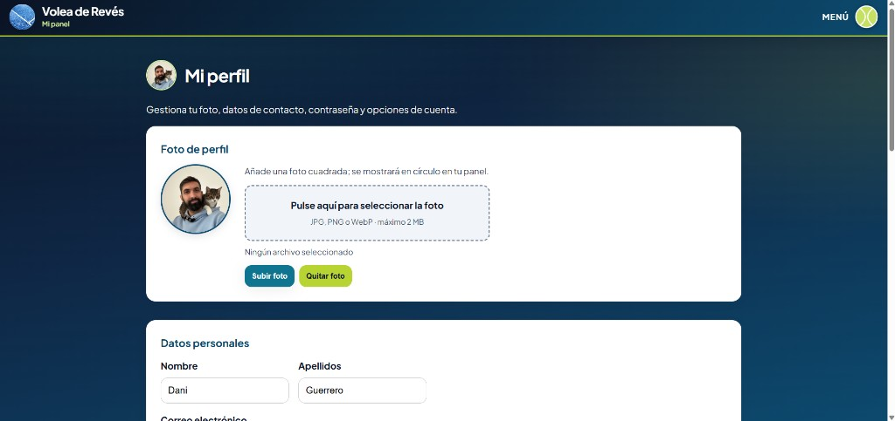

# Volea de Revés

Web platform to run padel leagues and "Pull" tournaments for a local club. Players register, form pairs, join leagues, report match results and follow live standings; admins manage competitions, groups, schedules and disputes.

**Live demo:** https://voleadereves.infinityfreeapp.com
(free hosting: the first load can be slow or show an anti-bot check)

**Demo player account** (read-only use; not an admin):

- Email: `danielnavas711900+demo1@gmail.com`
- Password: `demo1demo1`

| Home | Player dashboard | Profile |
|---|---|---|
|  |  |  |

> The UI is in Spanish (target users are Spanish players); code comments and docs are mostly Spanish too.

## Features

- **Accounts:** registration with email PIN verification, login, password recovery, profile with avatar, account deletion.
- **Pairs:** search for a partner, send/accept invitations, a pair is active with two confirmed members.
- **Leagues:** single or multi-group leagues, round-robin schedule generation, configurable points per win/loss.
- **Match flow:** one pair reports the score set by set, the rival accepts or disputes it; unconfirmed results are auto-validated after 24 h. Disputes go to an admin queue.
- **Standings:** per group and global, with tiebreakers (points → wins → set difference → game difference).
- **Pulls:** individual sign-up tournaments with court rotation and changing partners.
- **Admin panel:** users, pairs, competitions, sign-ups, calendar, incidents and match corrections.
- **Notifications:** in-app notifications for pending results and upcoming matches.

## Tech stack

| Layer | Technology |
|---|---|
| Backend | PHP 8 (no framework), PDO with prepared statements |
| Database | MySQL 8 (InnoDB, foreign keys, utf8mb4) |
| Frontend | Server-rendered HTML, CSS, vanilla JavaScript |
| Mail | PHPMailer over SMTP |
| Local environment | Docker Compose (Apache + PHP, MySQL, phpMyAdmin) |
| CI/CD | GitHub Actions: secrets guard on every push, manual FTPS deploy |
| Hosting | InfinityFree (shared Apache hosting) |

## Run locally

Requirements: Docker Desktop.

```bash
cp .env.example .env      # adjust passwords if you want
docker compose up -d --build
```

- App: http://localhost:8000
- phpMyAdmin: http://localhost:8080
- Health check: http://localhost:8000/health.php

On first start MySQL loads the schema and seed data from `sql/liga_padel_init.sql`. The seed includes a local-only admin user (`admin@liga-padel.local`); set your own password for it before using the app outside your machine.

Run the tests (they use the Docker database):

```bash
docker compose exec web php tests/run.php
```

## Project structure

```
admin/        Admin panel pages
usuario/      Player area pages
includes/     Services and shared logic (auth, matches, standings, pairs, mail…)
config/       Database connection
cron/         Scheduled jobs
sql/          Schema, seed and incremental migrations
tests/        Test suite (custom lightweight runner)
docs/screenshots/  Images used in this README
```

Pages handle HTTP and rendering; business rules live in services under `includes/` (for example `match_service.php`, `standings_service.php`, `pair_service.php`).

## Highlights

### Data model

20 tables designed around the **pair** as the competing entity, separate from user accounts:

- `usuarios`, `parejas`, `pareja_miembros`, `pareja_invitaciones`
- `competiciones`, `competicion_grupos`, `inscripciones` (leagues) and `inscripciones_pull`, `pull_rondas`, `pull_pista_slots` (Pulls)
- `partidos`, `partido_sets`, `clasificacion_parejas`
- `partido_integrantes_snapshot`: when a match is validated, the four players are frozen, so history stays correct even if a pair changes later.
- `audit_log`, `login_attempts`, `registro_attempts`, `configuracion`

Standings are only updated through the standings service inside transactions (`SELECT … FOR UPDATE` when reporting results), and can be recalculated from validated matches. Tiebreak order: points, wins, set difference, game difference.

### Scheduled jobs

- `cron/auto_validar_partidos.php`: validates results the rival did not answer within 24 h and applies league points.
- `cron/notificaciones_partidos.php`: creates reminders for upcoming matches.

Both run from the CLI or over HTTP protected by a shared secret (`CRON_SECRET`, compared in constant time), because the hosting has no CLI cron.

### Tests

`tests/run.php` runs suites for score validation, standings and tiebreakers, match and league services, pair rules, schema checks, CSRF, mailer and password reset tokens.

### Deployment

- Secrets (`.env`, `includes/env.php`, mail config) never enter the repository; a GitHub Actions workflow fails the build if they do.
- Deploy is a manual GitHub Actions workflow that syncs the code over FTPS and excludes secrets, tests, docs, SQL and user uploads.
- Apache `.htaccess` blocks internal folders (`config`, `includes`, `sql`, `storage`…) and serves clean URLs without `.php`.

### Security audit

I audited the app against a 20-point checklist (secrets, access control, injection, XSS, rate limiting, uploads, error handling…) and fixed what I found:

- All SQL uses prepared statements; every POST form checks a CSRF token; output is escaped.
- Passwords hashed with bcrypt plus a password policy; reset tokens are random 256-bit values stored as SHA-256 hashes with 1 h expiry.
- Login, recovery and registration are rate limited per IP and per email; the client IP cannot be spoofed through `X-Forwarded-For`.
- Sessions: HttpOnly, SameSite=Strict, Secure cookies; role and active status are re-checked against the database on every request.
- Ownership checks on every match action (a player can only act on their own pair's matches).
- Uploaded avatars are validated by content, size-limited and re-encoded with GD, which strips EXIF/GPS metadata, and saved under random file names.
- In production, errors go to a log file and users see a generic error page (no stack traces).
- Security headers: CSP (`frame-ancestors`, `form-action`), HSTS, `X-Content-Type-Options`, `X-Frame-Options`.

## How it was built

I built and maintain it myself, using AI coding tools (Cursor) and reviewing every change. I also handled the production side: database migrations on shared hosting, failed deploys and environment configuration issues.
