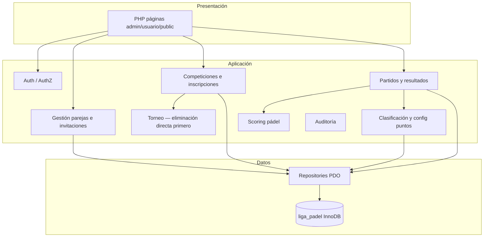

# Arquitectura — Liga y torneos de pádel

Documento de Fase 2. Estado del código PHP legacy: sin refactorizar; este diseño guía las fases 3+.

## Stack confirmado (repositorio)

| Capa | Tecnología |
|------|------------|
| Runtime | PHP 8.2 + Apache (`Dockerfile`) |
| Datos | MySQL 8 (`docker-compose.yml`) |
| Acceso datos | PDO, consultas mayormente en páginas |
| Frontend | HTML, CSS (`assets/css/style.css`), JS (`assets/js/app.js`) |
| Contenedor | Docker Compose (web, db, phpMyAdmin) |

## Principios

1. **Pádel only** en esta copia; sin compatibilidad con tenis.
2. **Competiciones** unifican ligas y torneos en modelo común; formatos de torneo evolucionan por fases.
3. **Pareja** como entidad; usuarios solo para acceso e identidad personal.
4. **Historial inmutable**: snapshot de integrantes por partido validado.
5. **Reglas de liga configurables** (puntos victoria/derrota), separadas del marcador del encuentro.
6. **Lógica centralizada** en servicios PHP (sin framework); las páginas orquestan HTTP.

## Estructura de carpetas objetivo (evolución gradual)

```
config/           # database.php, rutas futuras
includes/         # auth, security, env.php (nuevo)
src/
  Domain/         # Entidades ligeras, enums (estados)
  Repository/     # PDO por agregado
  Service/        # Negocio transaccional
  Scoring/        # Validación marcador pádel, reglas de formato
  League/         # Clasificación, desempates, puntos configurables
  Tournament/     # Cuadros (fases posteriores; interfaces en Fase 2)
public/           # index, login… (actual raíz; opcional mover después)
admin/
usuario/
tests/
sql/              # liga_padel_init.sql
docs/
scripts/          # importación manual en volúmenes ya existentes
```

No se mueve la raíz en Fase 2; se documenta la meta para evitar big-bang.

## Capas y responsabilidades



| Módulo | Responsabilidad |
|--------|-----------------|
| Configuración | `env.php`, `database.php`, claves `configuracion` |
| Auth | Sesión, login, roles (`includes/auth.php` + ampliación) |
| AuthZ | Comprobar en servidor: admin, dueño de pareja, participante del partido |
| Parejas | CRUD pareja, miembros, invitaciones, confirmación (2 titulares activos) |
| Competiciones | Liga general/grupos; torneo con `formato_torneo` |
| Inscripciones | Pareja ↔ competición (+ grupo); estados y UNIQUE |
| Partidos | Pareja A vs B, fase, ronda, estado, validación |
| Scoring | Sets en tabla; validación según `formato_partido`; ganador del encuentro |
| Liga | Aplicar puntos desde config; actualizar `clasificacion_parejas`; desempates |
| Torneo | Fase 1: eliminación directa; fases 2–3: grupos y híbrido (interfaces) |
| Admin | Config puntos, auditoría, resolución disputas |
| Presentación | Solo render; sin SQL ni reglas de negocio |

## Flujos de estado — partido y clasificación

| Evento | Partido | Clasificación liga | Snapshot |
|--------|---------|-------------------|----------|
| Registrar resultado | `pendiente`, sets borrador | Sin cambio | No |
| Validar (rival/admin/cron) | `validado`, fijar ganador | +puntos config a cada pareja | **Insert snapshot** 4 jugadores |
| Impugnar / rechazar | `rechazado`, motivo | Sin cambio si no estaba validado | No |
| Corregir marcador validado | Transacción: revertir puntos, actualizar sets, re-aplicar | Recalcular filas afectadas | Nuevo snapshot o versión (decisión Fase 6) |
| Anular partido validado | `anulado` | Revertir puntos | Snapshot conservado |
| Recalcular competición | — | Job admin: recomputar desde partidos `validado` | — |

Toda mutación de clasificación pasa por `LeagueStandingsService`; prohibido `UPDATE clasificacion` desde páginas (deuda actual en `dashboard.php`, `partidos.php`, `admin/partidos.php`).

## Ligas — modalidades aprobadas

- **General**: una competición liga con un grupo lógico «General» (fila en `competicion_grupos`) y una clasificación.
- **Por grupos**: N grupos; clasificación por `(competicion_id, grupo_id)`; clasificación global opcional vía vista/reglas documentadas (puntos normalizados o solo informativa — pendiente regla exacta en Fase 5).

## Torneos — roadmap

| Orden | Formato | `formato_torneo` | Implementación |
|-------|---------|------------------|----------------|
| 1 | Eliminación directa | `eliminacion` | Fase torneos 1 |
| 2 | Fase de grupos | `grupos` | Fase torneos 2 |
| 3 | Grupos + eliminatorias | `grupos_eliminatoria` | Fase torneos 3 |

Campos reservados en `partidos`: `fase`, `ronda`, `posicion_cuadro`, `partido_siguiente_id` (nullable).

## Punto de entrada y salud (Fase 2)

- **`health.php`** (pendiente de crear en modo agente): comprueba PDO, existencia de tablas núcleo; no depende de tablas legacy `torneos`.
- Páginas legacy (`index.php`, etc.) seguirán fallando hasta migración por fases; es esperado.

## Verificación auditoría (Paso 1 — lectura código, oct 2026)

| Hallazgo | Estado verificado |
|----------|-------------------|
| Credenciales en `config/database.php` | **Sigue** (`admin_tenis`, password en claro) |
| `init.sql` con PII producción | **Sigue** montado en compose hacia volcado tenis |
| Tabla `torneos` ausente en Docker | **Causa**: init solo en primer arranque de volumen; posible volumen previo sin tablas |
| Sin FK en torneos/inscripciones legacy | **Sigue** en `init.sql` |
| CSRF parcial | **Sigue** (login/registro/inscripción; no en GET partidos) |
| SQL concatenado IDs | **Sigue** en partidos/dashboard admin |
| `includes/mailer.php` | **Ausente** |
| `requireLiga()` | **Sin uso** |
| Pruebas automatizadas | **Ninguna** |
| Docker en máquina dev | **No ejecutándose** al verificar Fase 2 |
