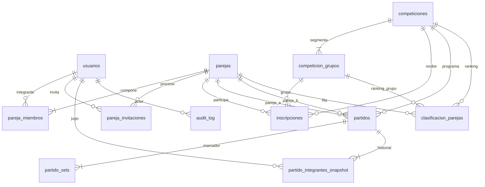

# Modelo de datos — `liga_padel`

Esquema objetivo InnoDB con claves foráneas. Script ejecutable: [`sql/liga_padel_init.sql`](../sql/liga_padel_init.sql) (crear en implementación).

## Diagrama ER

## Tablas

### `usuarios`

Cuentas de acceso. Sin mezclar con pareja competitiva.

| Columna | Tipo | Notas |
|---------|------|-------|
| id | INT PK AI | |
| nombre, apellidos | VARCHAR | |
| email | VARCHAR UNIQUE | |
| telefono | VARCHAR | |
| password | VARCHAR(255) | bcrypt |
| rol | ENUM admin, usuario | |
| activo | TINYINT | |
| email_verificado | TINYINT | |
| codigo_verificacion | VARCHAR(6) NULL | PIN |
| intentos_pin, expiracion_pin | | |
| token_recuperacion, expiracion_token | | |
| fecha_registro | TIMESTAMP | |

### `parejas`

| Columna | Tipo | Notas |
|---------|------|-------|
| id | INT PK AI | |
| nombre_display | VARCHAR(120) NULL | opcional |
| estado | ENUM borrador, activa, inactiva, disuelta | |
| creado_por_usuario_id | FK usuarios | |
| creado_en | TIMESTAMP | |

### `pareja_miembros`

| Columna | Tipo | Notas |
|---------|------|-------|
| id | INT PK AI | |
| pareja_id | FK parejas | ON DELETE RESTRICT |
| usuario_id | FK usuarios | |
| rol | ENUM titular, suplente | pádel: 2 titulares |
| activo | TINYINT(1) | |
| desde | DATETIME | |
| hasta | DATETIME NULL | baja histórica |
| UNIQUE (pareja_id, usuario_id) | | |

**Restricción backend (no SQL simple):** exactamente 2 titulares `activo=1` para inscribir o jugar.

### `pareja_invitaciones`

| Columna | Tipo | Notas |
|---------|------|-------|
| id | INT PK AI | |
| pareja_id | FK | |
| invitador_usuario_id | FK | |
| invitado_usuario_id | FK | |
| estado | ENUM pendiente, aceptada, rechazada, expirada | |
| expira_en | DATETIME | |
| respondido_en | DATETIME NULL | |

### `competiciones`

Entidad común liga / torneo.

| Columna | Tipo | Notas |
|---------|------|-------|
| id | INT PK AI | |
| tipo | ENUM liga, torneo | |
| nombre | VARCHAR | |
| descripcion | TEXT NULL | |
| estado | ENUM borrador, abierta, en_curso, finalizada, cancelada | |
| modalidad_liga | ENUM general, grupos NULL | solo si tipo=liga |
| formato_torneo | ENUM eliminacion, grupos, grupos_eliminatoria NULL | solo torneo |
| fecha_inicio, fecha_fin | DATE NULL | |
| cartel_ruta | VARCHAR NULL | |
| creado_en | TIMESTAMP | |

### `competicion_grupos`

Grupos de liga o fase de grupos de torneo.

| Columna | Tipo | Notas |
|---------|------|-------|
| id | INT PK AI | |
| competicion_id | FK | |
| nombre | VARCHAR | |
| orden | INT DEFAULT 0 | |
| UNIQUE (competicion_id, nombre) | | |

Liga **general**: un grupo «General» creado al abrir la competición.

### `inscripciones`

| Columna | Tipo | Notas |
|---------|------|-------|
| id | INT PK AI | |
| competicion_id | FK | |
| pareja_id | FK | |
| grupo_id | FK NULL | obligatorio si liga por grupos / fase grupos torneo |
| estado | ENUM pendiente, confirmada, rechazada, baja | |
| fecha_inscripcion | TIMESTAMP | |
| UNIQUE (competicion_id, pareja_id) | | |

### `partidos`

| Columna | Tipo | Notas |
|---------|------|-------|
| id | INT PK AI | |
| competicion_id | FK | |
| grupo_id | FK NULL | |
| fase | ENUM liga, grupos, eliminatoria, consolacion | |
| ronda | SMALLINT NULL | eliminatoria |
| posicion_cuadro | SMALLINT NULL | |
| partido_siguiente_id | FK partidos NULL | bracket |
| pareja_a_id, pareja_b_id | FK parejas | CHECK distintas (backend) |
| fecha | DATE, hora | TIME |
| estado | ENUM pendiente, validado, rechazado, anulado | |
| ganador_pareja_id | FK NULL | al validar |
| reportado_por_usuario_id | FK NULL | |
| motivo_rechazo | TEXT NULL | |
| formato_partido_codigo | VARCHAR(32) | ej. `best_of_3_standard` |
| fecha_registro | TIMESTAMP | |

### `partido_sets`

Sustituye marcador monolítico VARCHAR.

| Columna | Tipo | Notas |
|---------|------|-------|
| id | INT PK AI | |
| partido_id | FK ON DELETE RESTRICT | |
| numero_set | TINYINT | UNIQUE (partido_id, numero_set) |
| juegos_pareja_a | TINYINT | |
| juegos_pareja_b | TINYINT | |
| tiebreak_a, tiebreak_b | TINYINT NULL | |
| es_super_tiebreak | TINYINT(1) DEFAULT 0 | set 3 pádel |

### `partido_integrantes_snapshot`

Inmutable tras validación (solo admin con auditoría puede corregir con flujo explícito).

| Columna | Tipo | Notas |
|---------|------|-------|
| id | INT PK AI | |
| partido_id | FK | |
| pareja_id | FK | pareja en ese momento |
| lado | ENUM A, B | |
| usuario_id | FK | |
| orden_en_pareja | TINYINT 1|2 | |
| UNIQUE (partido_id, lado, orden_en_pareja) | | |

### `clasificacion_parejas`

| Columna | Tipo | Notas |
|---------|------|-------|
| id | INT PK AI | |
| competicion_id | FK | |
| grupo_id | FK NULL | NULL solo si una tabla global explícita |
| pareja_id | FK | |
| puntos | INT | desde config al validar |
| partidos_jugados, partidos_ganados | INT | |
| sets_favor, sets_contra | INT | |
| juegos_favor, juegos_contra | INT | desempate |
| UNIQUE (competicion_id, grupo_id, pareja_id) | | |

### `configuracion`

| Columna | Tipo | Notas |
|---------|------|-------|
| clave | VARCHAR(64) PK | |
| valor | TEXT | |
| actualizado_en | TIMESTAMP | |
| actualizado_por_usuario_id | FK NULL | |

Claves iniciales: `liga_puntos_victoria` = 180, `liga_puntos_derrota` = 50.

### `audit_log`

| Columna | Tipo | Notas |
|---------|------|-------|
| id | BIGINT PK AI | |
| usuario_id | FK NULL | |
| accion | VARCHAR(64) | |
| entidad | VARCHAR(64) | |
| entidad_id | INT NULL | |
| detalles | JSON NULL | |
| ip | VARCHAR(45) | |
| creado_en | TIMESTAMP | |

Acciones mínimas: validar/anular partido, cambiar config puntos, editar marcador admin, inscripción forzada.

### Seguridad (reutilizadas)

- `login_attempts`, `registro_attempts` — mismo propósito que legacy.

## Transición desde esquema tenis (sin importar PII)

| Legacy | Destino pádel |
|--------|----------------|
| `usuarios` | Migración selectiva futura o usuarios de prueba nuevos |
| `grupos` | `competicion_grupos` por competición |
| `clasificacion` | `clasificacion_parejas` |
| `partidos.jugador1/2` | `partidos` + snapshot |
| `torneos` | `competiciones` tipo torneo |
| `inscripciones_torneos` | `inscripciones` + parejas |

**Fase 2:** base nueva vacía + seeds ficticios; **no** migrar `init.sql` de producción.

## Restricciones solo en backend

- Dos titulares activos por pareja confirmada.
- Un usuario no puede aparecer en A y B del mismo partido.
- Pareja no puede jugar contra sí misma.
- Inscripción confirmada solo con pareja activa válida.
- Modificar resultado validado: transacción revertir puntos + auditoría.

## Datos de prueba (ficticios)

- Admin: `admin@liga-padel.local` / contraseña documentada en `entorno-local.md` (hash en SQL).
- 4 usuarios jugadores, 2 parejas, 1 liga general borrador, config 180/50.
