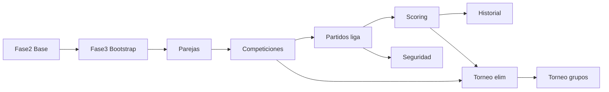

# Plan de implementación — pádel

Decisiones de negocio ya aprobadas; no replantear.

## Fase 2 — Base técnica ✅

| Entregable | Estado |
|------------|--------|
| Documentación arquitectura / datos / seguridad / entorno | Docs en `docs/` |
| Esquema `liga_padel` | `sql/liga_padel_init.sql` |
| Docker + `.env` | Implementado |
| Tests smoke | `tests/run.php` (57 tests) |
| Informe Fase 2 | `docs/fase-2-informe.md` |

**Fuera de alcance Fase 2:** UI parejas, partidos nuevos, torneos eliminatorios, migración páginas legacy.

## Fase 3 — Bootstrap aplicación ✅

- `includes/env.php`, `health.php` — hecho
- `includes/mailer.php` (stub configurable) — hecho
- Bootstrap único sesión — `includes/bootstrap.php`, `appEnsureSession()`
- Deprecar legacy tenis — `_legacy_deprecated/`, `instalacion_requerida.php`, `requireVoleaPadelInstall()`
- Informe: `docs/fase-3-informe.md`

## Fase 4 — Parejas ✅

- `includes/pair_service.php` (`PairService`: invitaciones, 2 titulares, disolución)
- `usuario/pareja.php`, `admin/parejas.php`
- Tests: `tests/PairServiceTest.php`
- Informe: `docs/fase-4-informe.md`

## Fase 5 — Competiciones e inscripciones ✅

- `includes/competition_service.php` (`LeagueCompetitionService`)
- Liga general / grupos, inscripción pendiente → confirmada, round robin
- `admin/grupos.php`, `admin/inscripciones_liga.php`, `usuario/ligas.php`
- Tests: `tests/CompetitionServiceTest.php`
- Informe: `docs/fase-5-informe.md`

## Fase 6 — Partidos liga ✅

- `includes/match_service.php` (`LeagueMatchService`), `includes/partido_snapshot.php`
- Reporte, validación rival/admin/cron, sets, puntos vía `padelApplyValidatedMatchPoints`
- `usuario/partidos.php`, `admin/partidos.php`, `usuario_padel_helpers.php`
- Tests: `tests/MatchServiceTest.php`
- Informe: `docs/fase-6-informe.md`

## Fase 7 — Scoring pádel + clasificación ✅

- `includes/scoring/` (`MatchFormat`, `ScoringValidator`)
- `includes/standings_service.php` (`LeagueStandingsService`)
- Desempates: `docs/desempates-liga.md`
- Tests: `ScoringValidatorTest.php`, `StandingsServiceTest.php`
- Informe: `docs/fase-7-informe.md`

## Fase 8 — Estadísticas e historial ✅

- `includes/history_service.php` (`LeagueHistoryService`)
- `usuario/historial.php`, clasificación global en `usuario/clasificacion.php`
- `docs/clasificacion-global-liga.md`
- Tests: `HistoryServiceTest.php`
- Informe: `docs/fase-8-informe.md`

## Fase 9 — UI pádel ✅

- `includes/padel_ui_helpers.php` (etiquetas pareja, enfrentamientos)
- CSS `league-table--padel`, tablas en `.table-responsive`
- `index.php`, área usuario y admin (partidos, parejas, inscripciones)
- Tests: `PadelUiHelpersTest.php`
- Informe: `docs/fase-9-informe.md`

## Fase 10 — Seguridad ✅

- `requirePostCsrf()` en admin partidos e incidencias
- Verificación email + PIN restaurada (`includes/mailer.php`, `includes/auth.php`, registro/login)
- `.env.example`: SMTP y `SKIP_EMAIL_VERIFICATION` solo para tests
- Tests: `tests/MailerTest.php`
- Informe: `docs/fase-10-informe.md`

## Fase 11 — Torneos 1: eliminación directa

- Generación bracket mínima
- Partidos `fase=eliminatoria`

## Fase 12 — Torneos 2–3

- Fase grupos
- Grupos + eliminatorias

## Fase 13 — Pruebas integración + despliegue

- PHPUnit o runner ampliado
- Documentación operación

## Dependencias

## Estrategia de pruebas

| Área | Tipo | Herramienta |
|------|------|-------------|
| Conexión BD | Smoke | `tests/DatabaseConnectionTest.php` |
| Tablas init | Smoke | `tests/SchemaTest.php` |
| Auth | Integración | Fase 3+ |
| Parejas / inscripciones | Integración | Fase 4–5 |
| Marcador / clasificación | Unit + integración | Fase 7 |
| Historial snapshot | Integración | Fase 6 |
| Concurrencia | Manual / futuro | Fase 13 |

Ejecutar: `docker compose exec web php tests/run.php`

**Nota:** Sin Docker/PHP local en verificación Fase 2 — no se declararon pruebas pasadas.

## Puntuación pádel (diseño Fase 2)

Separación conceptual:

1. **Formato de encuentro** (`formato_partido_codigo`): reglas de sets (best of 3, super TB en set 3, etc.).
2. **Validación marcador** (`ScoringValidator`): juegos por set, TB 6-6 — *pendiente aprobación reglamento club*.
3. **Ganador encuentro**: derivado de sets ganados.
4. **Puntos clasificación liga**: `configuracion` victoria/derrota; no dependen del marcador.
5. **Estadísticas**: sets/juegos en `clasificacion_parejas` y agregados futuros.
6. **Desempate**: orden propuesto — puntos, enfrentamiento directo (futuro), diferencia sets, diferencia juegos.

**Default propuesto (pendiente aprobación deportiva):**

- Best of 3 sets; sets a 6 juegos; tie-break a 6-6 a 7 puntos; set 3 = super tie-break a 10 puntos (pádel habitual en amateur).
- No reutilizar `esSetValido()` de tenis sin ampliación super TB.

## Criterios de aceptación Fase 2

- [x] Arquitectura documentada
- [x] Modelo datos documentado
- [x] BD `liga_padel` separada en Docker
- [x] Secretos fuera de código (`.env`)
- [x] SQL init sin PII
- [x] Pruebas ejecutadas con evidencia (`docs/fase-2-informe.md`)
